

# Clockwork – WoW CDM Addon

**Cooldowns, buffs, debuffs, bars and your class resource – laid out exactly how you want, and kept tidy in combat.**

For every class and spec · Retail (12.x) and WoW Forever (1.60.x)

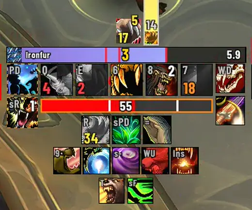

A Retail Guardian Druid fight. [Watch the full clip (mp4)](media/video/retail-guardian-live-collapse.mp4)

---

## What you get that most popular cooldown addons don't

- **Lightweight.** Built to stay light from the start: event-driven with no idle per-frame loops, a burst of game events in one frame becomes a single update, no new frames are created in combat, and animation runs only on icons that are glowing.
- **Show / Hide rules that do what you mean.** Per group and per cast bar: show or hide in combat, out of combat, with a target, on an enemy, mounted, dead, resting, in a dungeon, raid, PvP, delve or the open world. Combine several conditions per rule – *Show* always wins when rules disagree.
- **Keep its place while hidden – per element.** Each icon or bar decides for itself: hold its slot, or let its neighbours close up.
- **Collapse warnings with a one-click Fix.** A row that can't collapse (different icon sizes, a cooldown icon in an aura row) gets a yellow **!** in design mode, the reason in plain words, and a **Fix** button with one Undo.
- **Stance and form rules.** Show a group or icon only in Bear, Cat, Travel or caster form – or swap the spell per form – for every class with stances or forms.
- **Sounds per state.** A sound when a cooldown is ready, a buff starts or a buff ends.
- **Stack timers counted from your casts.** See every running stack of Ironfur (and similar effects) as its own timer, counted from your casts, even in combat.
- **Auto that knows the unit.** Aura bars and icons on *Auto* watch you or your target from the game's own spell data and what Clockwork has seen – a debuff on your target is found without you picking the unit.
- **Rotation assist (Retail).** Clockwork highlights the spell Blizzard's assisted combat suggests next right on your own icons, and a *Single-Button Assistant* icon shows the suggested spell live – your layout, your look, no action bar needed.
- **Pixel-perfect.** Borders, gaps and bars land on whole screen pixels at any UI scale – no blurry or uneven edges.
- **Potions tracked by name, not by rank.** One potion icon covers every quality tier (1–3 stars, silver or gold): it shows whichever tier is in your bags, its count and its cooldown – no separate icon per rank, no re-setup when you craft or buy a different tier.

## More in Clockwork

- **Collapse that works in combat.** When a buff drops, its row closes the gap in the middle of the fight. An empty row lets the next row drop into its place, and bars that appear (cast bar, stack timers) push the row aside and give the space back.
- **Import your Coolinator profiles.** Already set up in Coolinator? Bring your layouts, spells, groups and positions over with one click (*Options → General → Import from Coolinator*) and keep tuning them in Clockwork.
- **A visual drag-and-drop designer.** Drag spells, buffs, bars and groups straight onto the screen. Snap to edges, centre lines and a grid. Undo included.
- **Presets.** One look shared by many icons or bars. Change the preset once, every element using it follows. Detach any element for a private copy.
- **Retail and WoW Forever.** One addon, both clients.

---

## Features

### Groups: rows, columns and free layouts

Put icons and bars in groups, and groups inside groups. Each group has its own layout, spacing, alignment and **Grow from** point, so a nested row can grow from its centre while its parent column grows upward.

Full guide: [Groups & growth tutorial](docs/groups-and-growth.md).

### Collapse in combat

Retail Restoration Shaman. [Full clip (mp4)](media/video/retail-resto-shaman.mp4)

Hidden icons take no place. A buff drops and its row closes up; row 2 drops onto an empty row 1; the side bars meet in the middle. This is the default **Frozen** engine: Clockwork works out every row's positions out of combat and swaps between them in the fight. Under *Behaviour → Hidden icons → In combat* you can also try **Live** (beta), where Blizzard measures the rows itself – side bars in some layouts may still overlap a little; a fix is coming.

Clockwork lays everything out out of combat. In combat, Blizzard's own aura frames move the icons, so the layout keeps working while aura data is hidden from addons.

### Keep its place, or close the gap

Per bar: *Keep its place while hidden* holds an empty slot so nothing around it moves; untick it and the neighbours close up.

### Collapse warnings with a Fix

When something stops a row from collapsing – an icon of a different size in the middle, say – the group gets a yellow **!**. Its tooltip names the cause, and the group's General tab has a **Fix** button. Turn *Collapse warnings* on in Behaviour to also get a line in chat.

### Presets

Each element type has its own preset list: spell icons, aura icons, cast bars, aura bars, power bars, groups. A preset holds the look (size, style, texts, glow, swipe, colours); the spell, form rules and sounds stay on the element.

- **When inactive**: Hide, Dim or Desaturate.
- **Glows**: Pixel glow, Marching ants, Static glow, or Blizzard's own proc glow – with colour, thickness, speed and offset.

### Bars

- **Aura bars** for any buff or debuff, horizontal or vertical, with an icon and texts.
- **Stack timers**: one bar for every active application, with a tick per cast.
- **Cast bar** with colours for casting, channeling, can't-interrupt, interrupted, finished and every empower stage, plus a latency zone and its own Show / Hide rules.
- **Auto width**: a bar fits the longest item of its row or column.

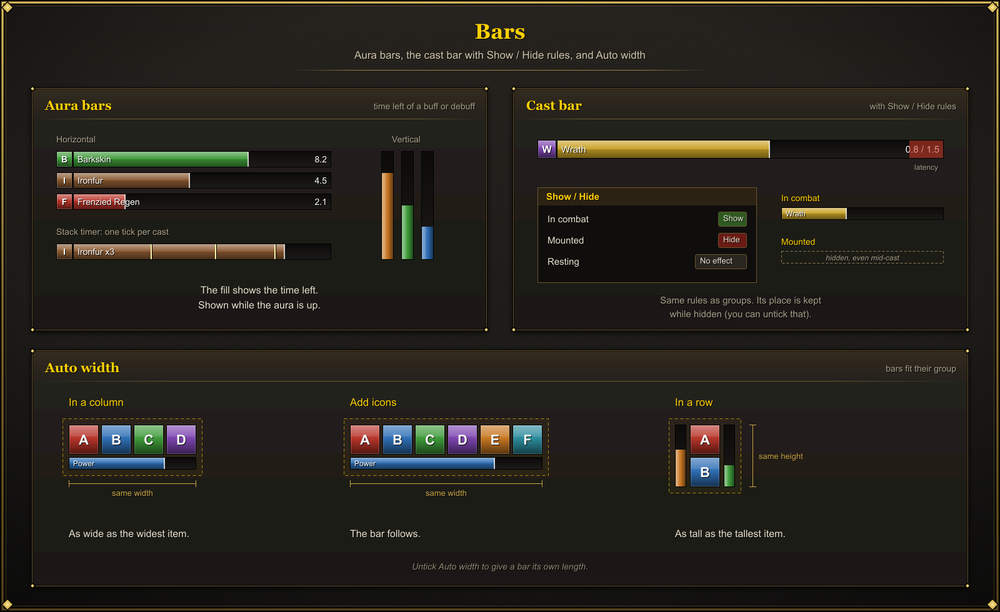

### Power bar and class resource

WoW Forever Druid, switching forms. [Full clip (mp4)](media/video/forever-druid-forms.mp4)

The power bar follows your form: Mana in caster form, Rage in Bear, Energy in Cat – or pick a different power per form. Up to three texts, five tick marks per power, and your class resource as pips: combo points, holy power, soul shards, runes, chi, arcane charges, essence. Stagger for Brewmasters.

### Icons that know what you're doing

- **Track**: cooldowns, charges, your buffs, debuffs on you, your debuffs on the target, and missing buffs.
- **Items and trinkets**: usable items from your bags and on-use equipment.
- **Stance and form rules** on every item, read from the game for every class: Druid forms, Warrior stances, Stealth, Shadowform, Ghost Wolf and more. Swap the spell per form (Maul in Bear, Shred in Cat).
- **Sounds per state**: when ready, when on cooldown, when missing resources, when a buff starts or ends.
- **Keybinds** on icons, including macros and popular action-bar addons.
- **Key press feedback**: the icon shows the pushed look or a flash when you press its key.
- **Spells you haven't learned** hide and take no place (shown grey in design mode).
- **Retail only**: highlight Blizzard's suggested next spell, and a Single-Button Assistant icon that shows the current suggestion.

### Show / Hide rules

Every group – and the cast bar and power bar – can show or hide by situation: in combat, with a target, in a dungeon, raid or PvP, mounted, resting and more. A Quick setup button covers the common case.

---

## Design mode

Type `/cwk d` (or press **Design mode** in the settings). Everything unlocks.

- **Drag** to move. **Alt+drag** moves freely without joining a group. **Shift-click** selects more; edit several at once.
- **Snap** to other elements, the screen centre and a grid (Grid W / Grid H).
- **Drag onto the screen** from the palette: Spell icon, Buff icon, Missing buff, Item, Cast bar, Group, Spacer, Power bar. Drop on the bin to delete.
- **Click** an element to open its settings. **Right-click** for more: insert left / right / above / below, move out of group, ungroup, stack, delete.
- **Undo**, and **Tidy wrappers** to remove groups that only wrap one thing (only where nothing on screen moves).

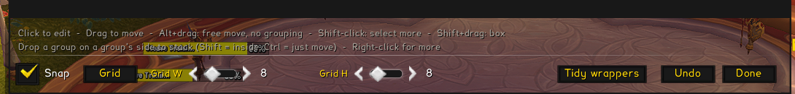

---

## Every window

<b>Settings window</b> (General, Behaviour, Font, Elements)

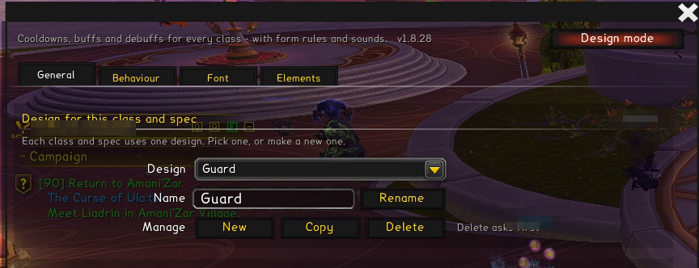

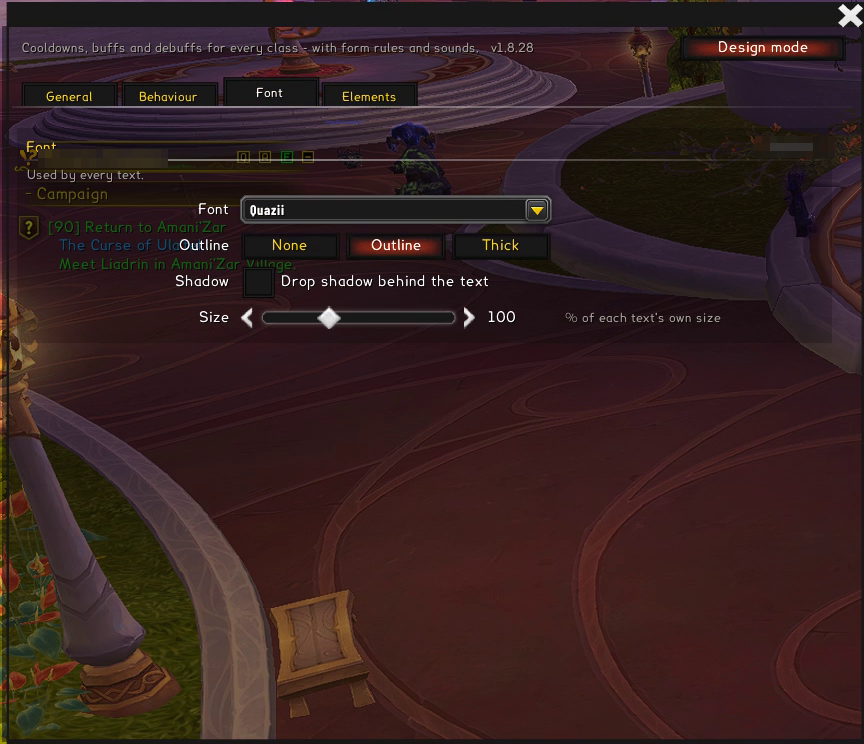

<b>Design mode</b> (enter, toolbar, selected group, add menu)

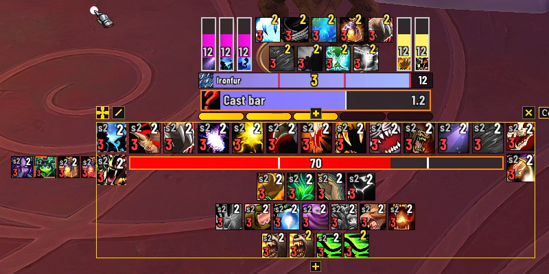

<b>Icon</b> (General, Spell, Texts, Cooldown, Active, Forms, Create preset)

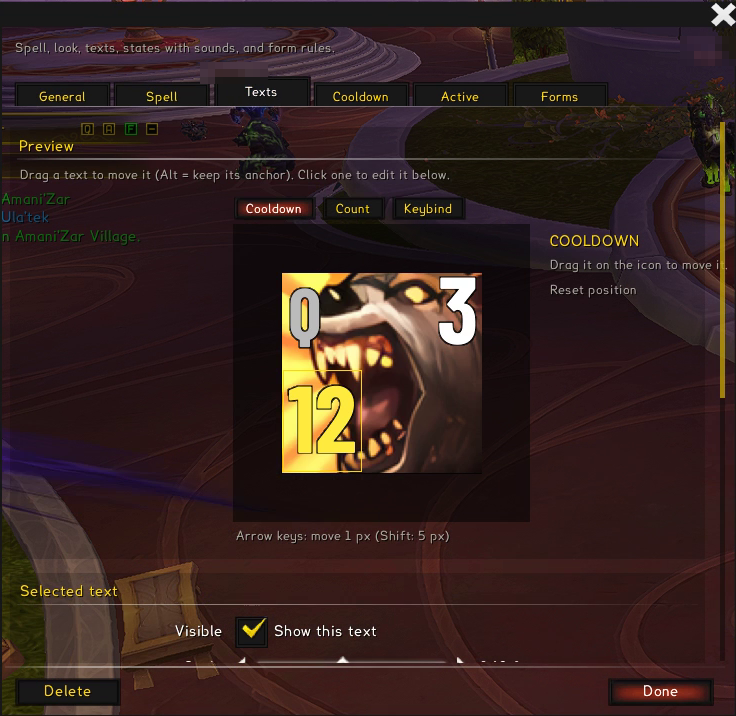
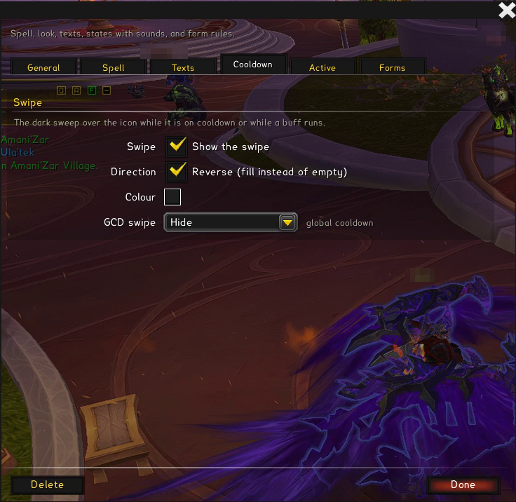
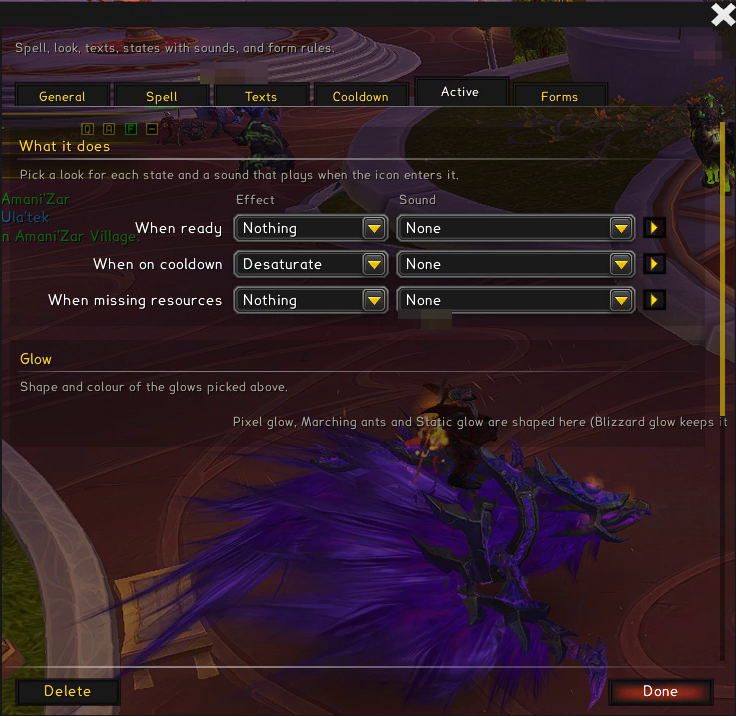

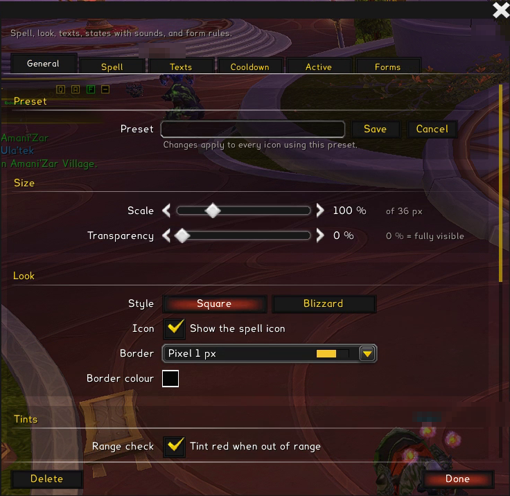

<b>Group</b> (General, Show / Hide)

<b>Aura bar</b> (General, Bar, Colors, Texts, Forms)

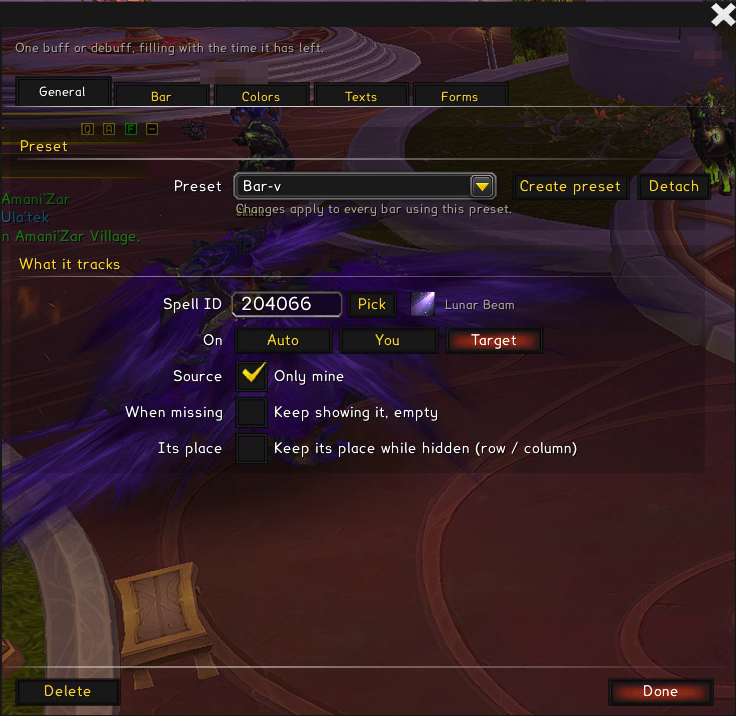

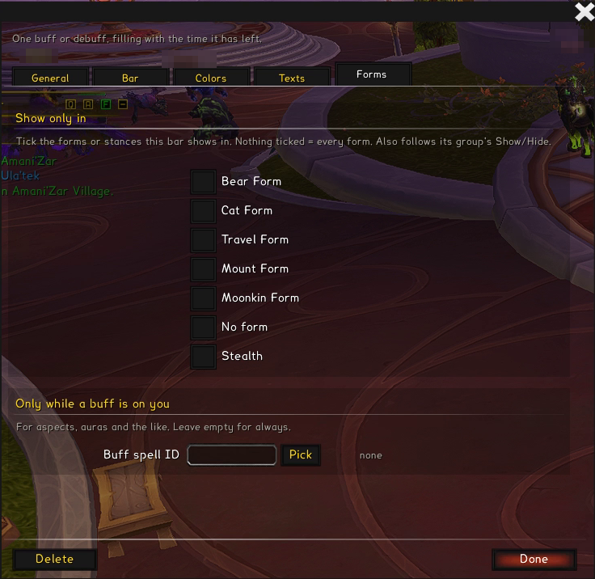

<b>Cast bar</b> (General, Bar, Colors, Texts)

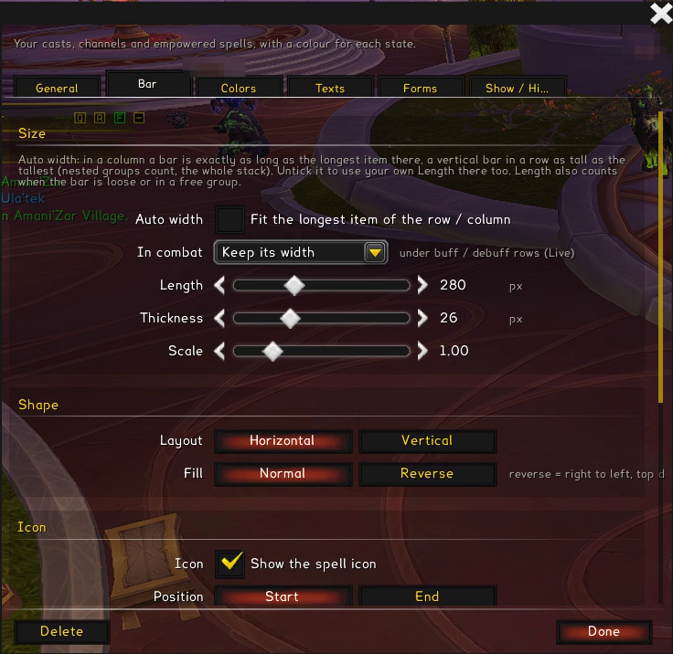
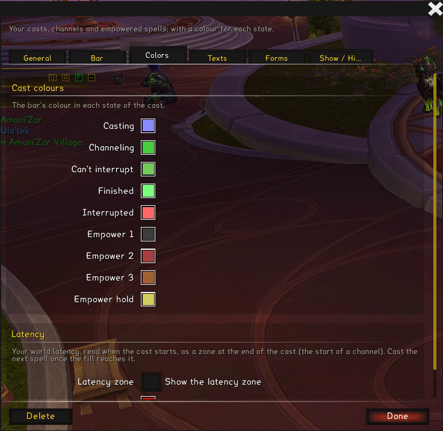

<b>Power bar</b> (General, Look, Texts, Forms, Show / Hide)

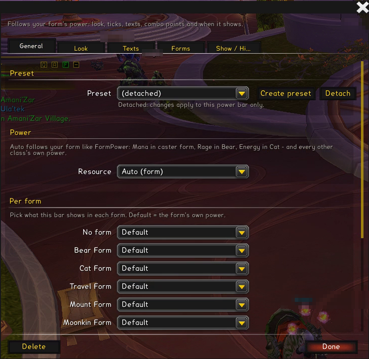
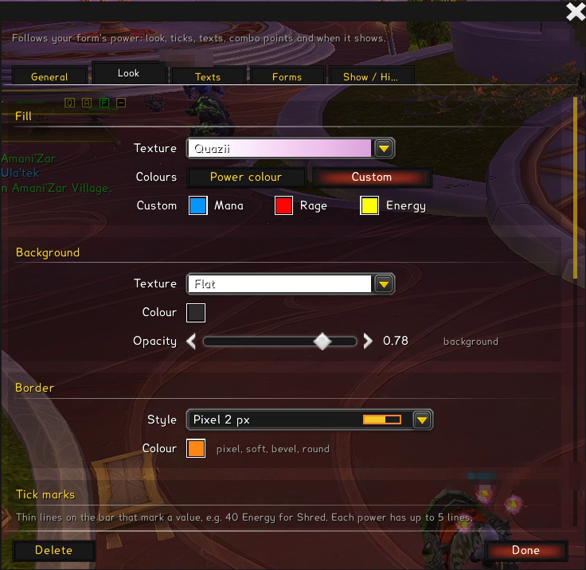

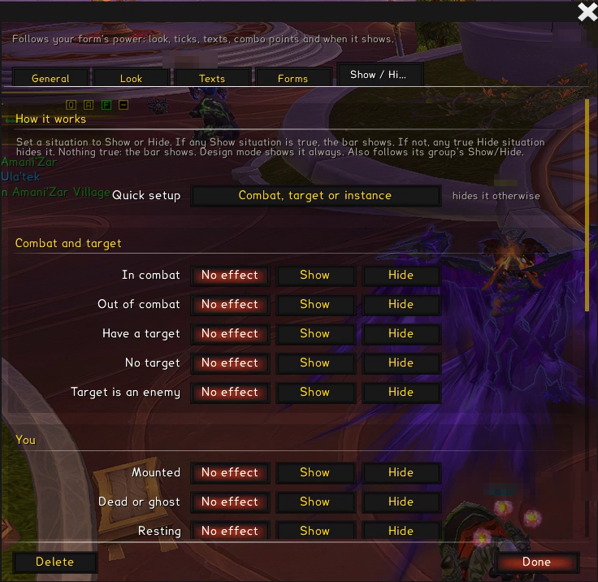

<b>Pickers</b> (spells, buffs, items, equipment)

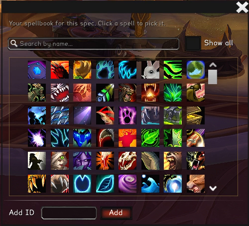

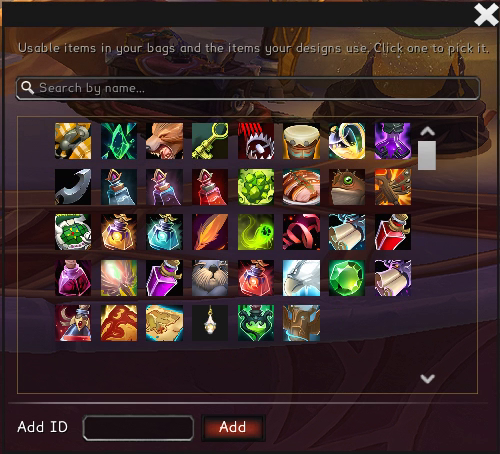

---

## Install

1. Get Clockwork from [CurseForge](https://www.curseforge.com/projects/1819552) – the easiest way is the CurseForge app, which also keeps it up to date. Or press **Download** on the CurseForge page.
2. If you downloaded the zip yourself, unzip it. You get a folder named `Clockwork`.
3. Put that folder in your AddOns folder:
   - Retail: `World of Warcraft/_retail_/Interface/AddOns/`
   - WoW Forever: `World of Warcraft/_forever_/Interface/AddOns/`
4. Start the game (or `/reload`) and make sure Clockwork is ticked in the AddOns list.

## Quick start

New to Clockwork? On your first login a **Choose a starter layout** window offers a ready-made layout for your class and spec (Compact, Wide, or Healer). Pick one and tune it – or type `/cwk starter` any time.

1. Type `/cwk` to open the settings.
2. Each class and spec has its own design, picked automatically. Make a new one under *General → Design for this class and spec*.
3. Press **Design mode** (or `/cwk d`) and drag a Spell icon, Buff icon or bar from the palette onto the screen.
4. Click it to pick the spell, then give it a **Preset** – or **Create preset** to reuse the look on other icons.
5. Press **Done**.

## Slash commands

| Command | What it does |
|---|---|
| `/cwk` (or `/clockwork`) | Open or close the settings window |
| `/cwk d` | Design mode (drag to move, Alt+drag = free move, Shift-click = select more) |
| `/cwk help` | List the commands in chat |
| `/cwk debug` | Save a debug report for bug reports, then `/reload` |
| `/cwk auras` | Check what every aura icon sees now (in and out of combat), then `/reload` |
| `/cwk livetest` | Check the calls the live collapse uses (in and out of combat) |
| `/cwk tidy` | Remove groups that only wrap one thing (only where nothing moves; Undo in design mode) |
| `/cwk aliases reset` | Forget the aura IDs Clockwork learned for your aura icons |
| `/cwk starter` | Add a ready-made starter layout for your class and spec (deletes nothing) |
| `/cwk tour` | Show every window and tab by itself, 4 s each (`/cwk tour stop` ends it) |

## FAQ

**Does it work in combat?**
Yes. Cooldowns, charges, auras and bars all run in combat, and rows close up mid-fight. Design mode closes itself when combat starts.

**Retail or WoW Forever?**
Both: Retail 12.x and WoW Forever 1.60.x, from the same download.

**My row doesn't close the gap.**
Look for the yellow **!** on the group in design mode, read its tooltip and press **Fix** in the group's General tab. `/cwk debug` names the row, icon and reason.

**Live or Frozen?**
**Frozen** (the default, recommended) closes gaps in combat from positions Clockwork worked out beforehand. **Live** (beta) lets Blizzard measure the rows live; it can still overlap side bars a little in some layouts. Switch it under *Behaviour → Hidden icons → In combat*.

**Can I bring my Coolinator setup?**
Yes. *Options → General → Import from Coolinator* reads your Coolinator settings and adds its designs – spells, groups and positions – as Clockwork designs.

**Does it cost FPS?**
It's built to stay light: event-driven with no idle per-frame loops, several events in one frame become one update, no new frames are created in combat, and only glowing icons animate.

**Can I move or resize everything?**
Yes – everything is drag-and-drop in design mode, and every element has its own settings window.

## Discord

Join the [**Clockwork Discord**](https://discord.gg/j3TH89X9wZ) for help, bug reports, ideas and release news. Type `/bug` or `/idea` there for a quick form, and pick **Release Pings** in #welcome to hear about new versions.

## Ideas & feature requests

Missing an option? Clockwork grows from players' ideas – most of its features started as a request.
[**Suggest a feature**](https://github.com/xxxstar123/Clockwork-WoW-CDM-Addon/issues/new?template=feature_request.yml) – tell us what you want it to do and for which class / spec. Or post it in the [Discord](https://discord.gg/j3TH89X9wZ) (`/idea`).

## Bug reports

Open a [**bug report**](https://github.com/xxxstar123/Clockwork-WoW-CDM-Addon/issues/new?template=bug_report.yml), or use `/bug` in the [Discord](https://discord.gg/j3TH89X9wZ). Please include:

1. Your client (Retail or Forever) and Clockwork version.
2. What you did, what you expected, and what happened.
3. A debug report: type `/cwk debug`, then `/reload`. The report is saved in `WTF/Account/<account>/SavedVariables/Clockwork.lua`. Attach that file (check it first – it holds your Clockwork settings).

## Support Clockwork

Clockwork is free. If it helps you, you can support its development – entirely optional, and much appreciated.

## Licence

Copyright © 2026 xxxstar123. **All rights reserved.**
You are free to download Clockwork and use it in the game. Copying, modifying or redistributing the code requires written permission, and **no AI use** is allowed – no training, and no AI tools or agents reusing the code. See [LICENSE](LICENSE) and [AGENTS.md](AGENTS.md).

See [CHANGELOG.md](CHANGELOG.md) for recent changes.
