

# Clockwork – WoW CDM Addon

**Cooldowns, buffs, debuffs, bars and your class resource – laid out exactly how you want, and kept tidy in combat.**

For every class and spec · Retail (12.x) and WoW Forever (1.60.x)

A Retail Guardian Druid fight. [Watch the full clip (mp4)](https://github.com/xxxstar123/Clockwork-WoW-CDM-Addon/blob/main/media/video/retail-guardian-live-collapse.mp4)

---

## What you get that most popular cooldown addons don't

- **Lightweight.** Built to stay light from the start: event-driven, a burst of game events in one frame becomes a single update, and the pieces a fight can show (proc glow, glow lines, timer text, highlights) are made before combat, not on their first show. Per-frame work runs only for what is moving on screen – glowing icons (capped at about 60 redraws a second), running timers, cast and swing bars – and, in combat, for collapsing rows that close gaps around buffs and target debuffs.
- **Show / Hide rules that do what you mean.** Per group and per cast bar: show or hide in combat, out of combat, with a target, on an enemy, mounted, dead, resting, in a dungeon, raid, PvP, delve or the open world. Combine several conditions per rule – *Show* always wins when rules disagree.
- **Keep its place while hidden – per element.** Each icon or bar decides for itself: hold its slot, or let its neighbors close up.
- **Collapse warnings with a one-click Fix.** A row that can't collapse (different icon sizes, a cooldown icon in an aura row) gets a yellow **!** in design mode, the reason in plain words, and a **Fix** button with one Undo.
- **Stance and form rules.** Show a group or icon only in Bear, Cat, Travel or caster form – or swap the spell per form – for every class with stances or forms.
- **Sounds per state.** A sound when a cooldown is ready, a buff starts or a buff ends.
- **Every text is yours to place.** The stack number, cooldown, keybind, spell name, timer and latency texts on icons and bars can each be dragged to any spot, resized, recolored, rotated, shortened or hidden. Drag them in a live preview of the real element: they snap to its corners, edges or center, and the arrow keys fine-tune by the pixel.
- **Stack timers counted from your casts.** See every running stack of Ironfur (and similar effects) as its own timer, counted from your casts, even in combat.
- **Auto that knows the unit.** Aura bars and icons on *Auto* watch you or your target from the game's own spell data and what Clockwork has seen – a debuff on your target is found without you picking the unit.
- **Rotation assist (Retail).** Clockwork highlights the spell Blizzard's assisted combat suggests next right on your own icons, and a *Single-Button Assistant* icon shows the suggested spell live – your layout, your look, no action bar needed.
- **Pixel-perfect.** Borders, gaps and bars land on whole screen pixels at any UI scale – no blurry or uneven edges.
- **Potions tracked by name, not by rank.** One potion icon covers every quality tier (1–3 stars, silver or gold): it shows whichever tier is in your bags, its count and its cooldown – no separate icon per rank, no re-setup when you craft or buy a different tier.

## More in Clockwork

- **Collapse that works in combat.** When a buff drops, its row closes the gap in the middle of the fight. An empty row lets the next row drop into its place, and bars that appear (cast bar, stack timers) push the row aside and give the space back.
- **Import your Coolinator profiles.** Already set up in Coolinator? Bring your layouts, spells, groups and positions over with one click (*Options → General → Import from Coolinator*) and keep tuning them in Clockwork.
- **A visual drag-and-drop designer.** Drag spells, buffs, bars and groups straight onto the screen. Snap to edges, center lines and a grid. Undo included.
- **Presets.** One look shared by many icons or bars. Change the preset once, every element using it follows. Detach any element for a private copy.
- **Retail and WoW Forever.** One addon, both clients.

---

## Features

### Groups: rows, columns and free layouts

Put icons and bars in groups, and groups inside groups. Each group has its own layout, spacing, alignment and **Grow from** point, so a nested row can grow from its center while its parent column grows upward.

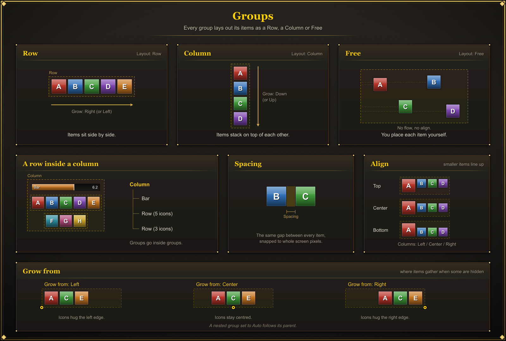

Full guide: [Groups & growth tutorial](docs/groups-and-growth.md).

### Collapse in combat

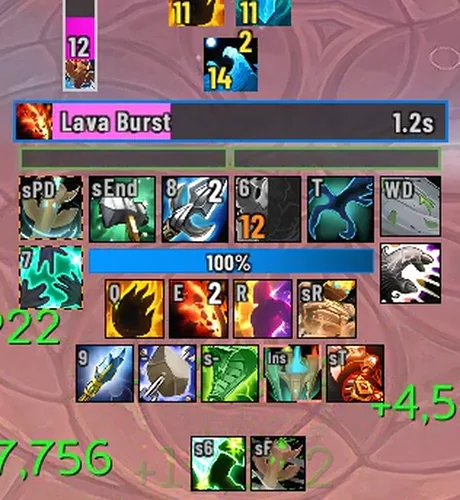

Retail Restoration Shaman. [Full clip (mp4)](https://github.com/xxxstar123/Clockwork-WoW-CDM-Addon/blob/main/media/video/retail-resto-shaman.mp4)

Hidden icons take no place. A buff drops and its row closes up; row 2 drops onto an empty row 1; the side bars meet in the middle. This is the default **Frozen** engine: Clockwork works out every row's positions out of combat and swaps between them in the fight. Under *Behavior → Hidden icons → In combat* you can also try **Live** (beta), where Blizzard measures the rows itself – side bars in some layouts may still overlap a little; a fix is coming.

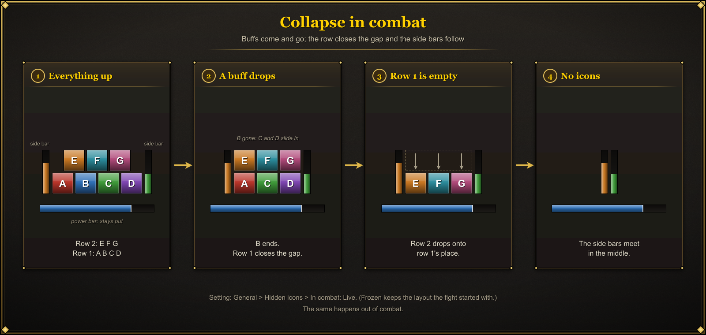

Clockwork lays everything out out of combat. In combat, Blizzard's own aura frames move the icons, so the layout keeps working while aura data is hidden from addons.

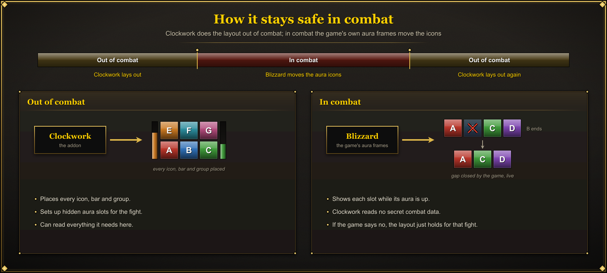

### Keep its place, or close the gap

Per bar: *Keep its place while hidden* holds an empty slot so nothing around it moves; untick it and the neighbors close up.

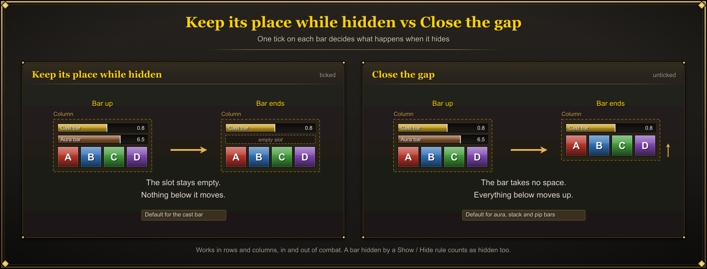

### Collapse warnings with a Fix

When something stops a row from collapsing – an icon of a different size in the middle, say – the group gets a yellow **!**. Its tooltip names the cause, and the group's General tab has a **Fix** button. Turn *Collapse warnings* on in Behavior to also get a line in chat.

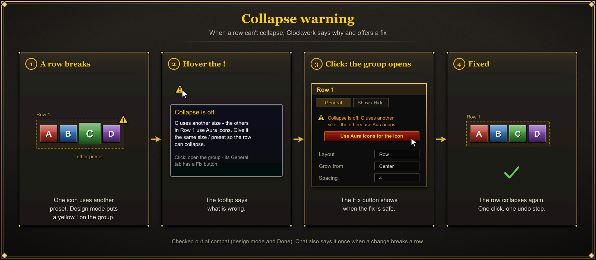

### Presets

Each element type has its own preset list: spell icons, aura icons, cast bars, aura bars, power bars, groups. A preset holds the look (size, style, texts, glow, swipe, colors); the spell, form rules and sounds stay on the element.

- **When inactive**: Hide, Dim or Desaturate.
- **Glows**: Pixel glow, Marching ants, Static glow, or Blizzard's own proc glow – with color, thickness, speed and offset.

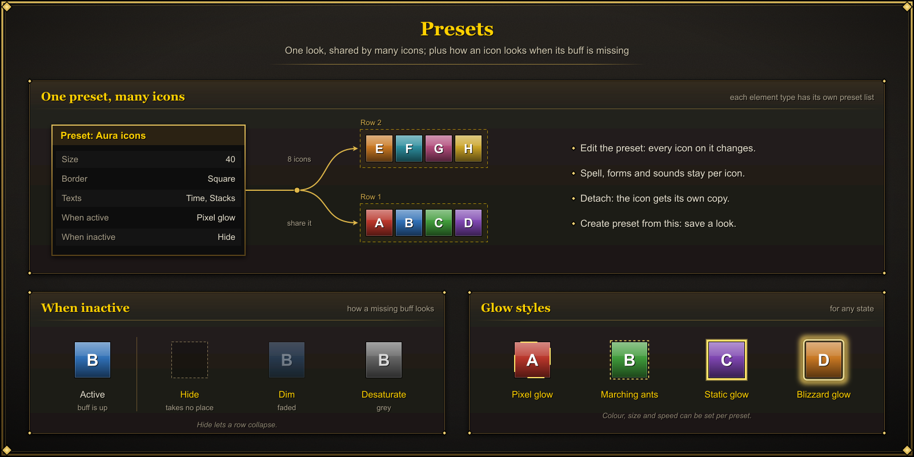

### Bars

- **Aura bars** for any buff or debuff, horizontal or vertical, with an icon and texts.
- **Stack timers**: one bar for every active application, with a tick per cast.
- **Cast bar** with colors for casting, channeling, can't-interrupt, interrupted, finished and every empower stage, plus a latency zone and its own Show / Hide rules.
- **Auto width**: a bar fits the longest item of its row or column.

### Power bar and class resource

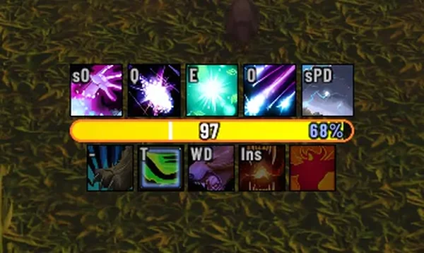

WoW Forever Druid, switching forms. [Full clip (mp4)](https://github.com/xxxstar123/Clockwork-WoW-CDM-Addon/blob/main/media/video/forever-druid-forms.mp4)

The power bar follows your form: Mana in caster form, Rage in Bear, Energy in Cat – or pick a different power per form. Up to three texts, five tick marks per power, and your class resource as pips: combo points, holy power, soul shards, runes, chi, arcane charges, essence. Stagger for Brewmasters.

### Icons that know what you're doing

- **Track**: cooldowns, charges, your buffs, debuffs on you, your debuffs on the target, and missing buffs.
- **Items and trinkets**: usable items from your bags and on-use equipment.
- **Item buffs**: show the buff a trinket or potion gives you – on-use buffs, trinket procs and potions – by slot (Trinket 1 / Trinket 2, follows gear swaps) or by exact item.
- **Stance and form rules** on every item, read from the game for every class: Druid forms, Warrior stances, Stealth, Shadowform, Ghost Wolf and more. Swap the spell per form (Maul in Bear, Shred in Cat).
- **Sounds per state**: when ready, when on cooldown, when missing resources, when a buff starts or ends.
- **Keybinds** on icons, including macros and popular action-bar addons.
- **Key press feedback**: the icon shows the pushed look or a flash when you press its key.
- **Spells you haven't learned** hide and take no place (shown gray in design mode).
- **Retail only**: highlight Blizzard's suggested next spell, and a Single-Button Assistant icon that shows the current suggestion.

### Show / Hide rules

Every group – and the cast bar and power bar – can show or hide by situation: in combat, with a target, in a dungeon, raid or PvP, mounted, resting and more. A Quick setup button covers the common case.

---

## Design mode

Design mode is where you build your layout on screen. Every group, icon and bar unlocks. You can drag things, add new ones, group them and line them up. Your character still moves with WASD and the camera still turns.

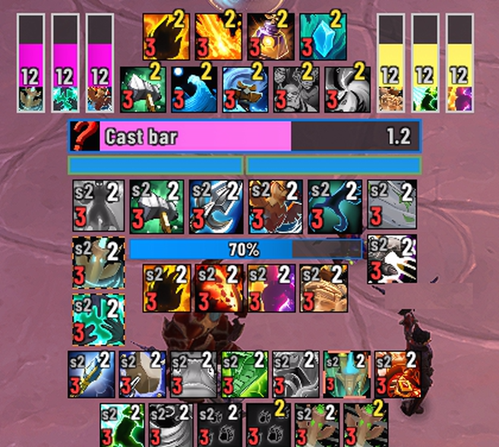

### Getting started

| Action | How |
|---|---|
| Open design mode | Type `/cwk d` (also `/cwk design`), or press **Design mode** at the top of the settings window (`/cwk`). |
| Leave design mode | Press **Done** on the banner, press **Esc**, type `/cwk d` again, or press **Leave design mode** in the settings window. |
| In combat | Design mode won't open in combat. If combat starts while it is open, it closes by itself. |

While design mode is on, every element is shown, even ones that are normally hidden. When you leave, your normal Show / Hide rules come back.

### Selecting

| Action | How |
|---|---|
| Select one element and open its settings | Left-click it. |
| Add to or remove from the selection | **Shift-click**. |
| Box select | **Shift+drag** on empty screen. Everything whose center is inside the box is selected. |
| Add a box to the selection | **Ctrl+Shift+drag**. |
| Clear the selection | **Shift-click** on empty screen. |
| Select the group around an item | Click the **Select group** button (small box icon) above it. Click it again on that group to go one more level up. |
| Edit several at once | Select them, then change a setting in the settings window. It shows "(N selected)" in its title. |

A plain click on empty screen goes to the game as usual (targeting, click-to-move). It does not change the selection.

**What you see**

- **Hover:** a thin gold outline and a name tag.
- **Selected:** a full gold outline and a name tag with white text. Groups get a thicker outline than icons and bars.
- **Empty group:** a dashed box with "Drop icons here", so you can still find it and drop things in.
- **Icons:** hover to see the spell's tooltip and its Spell ID (turn this off with the Tooltips option).

### Moving & snapping

Drag any element with the left mouse button. What happens on the drop depends on where it lives and where you drop it. You always see it first: the target group gets a gold frame, and a gold line shows where it will go in a row or column.

| Action | How |
|---|---|
| Move | Drag it. If it is selected with others, they all move together. |
| Free move (never join, stack or group) | Hold **Alt** while you drag. An item from a row or column comes out loose where you drop it. |
| Reorder inside a row or column | Drag the item along the row. The gold line shows the new spot. |
| Put an item into a group | Drop it inside the group. You can also drop it just past the end of a row or column. |
| Take an item out of a group | Drag it out of the group and drop it on empty screen. A gray **Free** label shows when it will become loose. You can also right-click it and choose **Move out of group**. |
| Put something between two groups | Drop it near the edge of a group inside a row or column. It goes beside that group, not into it. |
| Group two icons | Drop a loose icon on another loose icon. A gold **Group** label shows. Both go into a new row. |
| Stack groups | Drag a group onto another group. A gold **Stack** label and line show the side (above, below, left or right). The nearest side wins. |
| Drop a group *inside* another group | Hold **Shift** while you drop it. |
| Just move a group (no stacking) | Hold **Ctrl** while you drop it. |
| Delete | Drop it on **Drop here to delete** at the bottom of the palette. The box turns red when you are over it. |
| Turn the camera | Right-drag, as usual. A right-drag never opens a menu. |

**Snapping** (when **Snap** is ticked on the banner):

- Works on elements that sit loose on the screen (not inside a group).
- Snaps within 8 px to the screen center and to the edges and centers of other loose elements. A gold guide line shows what it snapped to.
- When nothing is close, it snaps to the grid (Grid W / Grid H).

A group that becomes empty because you moved or deleted its last item is removed by itself. A new empty group you added stays.

### The move handle

Select one element and a small square with a gold 4-way arrow appears in its exact center. Other buttons sit in a strip above the element.

| Control | What it does |
|---|---|
| **Move handle** (4 arrows, center) | Drag to move the element. Click to open its settings. Right-click for its quick menu (the same menu as right-clicking the element). |
| **Pencil** (groups) | Opens the group's settings. Tooltip: "Options". |
| **Select group** (small box, items and groups inside a group) | Selects the group around it. |
| **X** (top right) | Deletes it. Undo brings it back. |
| **Name tag** | Shows the element's name, next to the X. |
| **+** buttons | Add something new. Hover one to see a gold line where the new element will go. See below. |

**The + buttons**

- At both ends of a selected row or column: **Insert at start** / **Insert at end**. A free group has one **+** at its top right.
- Beside a selected item, along its row or column: **Insert before** / **Insert after**.
- Across its row or column: **Insert above** / **Insert below** (in a row) or **Insert left** / **Insert right** (in a column). This wraps the item and the new one in a new row or column.

Each **+** opens the add menu:

| Menu row | Choices |
|---|---|
| **Ability** | Icon, Bar, Charges, Charge bar |
| **Aura** | Icon, Bar, Stacks, Stack timers, Missing buff |
| **Item** | (an item icon) |
| **Equipment** | Pick an item..., Trinket 1, Trinket 2 |
| **Cast bar** | (your cast bar) |
| **Spacer** | (an empty gap) |
| **Class** | Your own class resources only, then **Auto (form)** |
| **Swing** | Main hand, Off hand, Ranged |
| **Group** | (a new empty group) |

Rows that aren't available yet are gray and marked "soon". The new element takes the look of the item next to it. Then the spell, aura or item picker opens so you can choose what it tracks. If there is nothing to pick, its settings open.

### Right-click menus

Right-click an element (or its move handle). The menu depends on what you clicked.

**A group**

| Entry | What it does |
|---|---|
| Options | Opens the group's settings. |
| Insert left / right / above / below ▸ | Only for a group inside another group. Opens the add menu for that side. |
| Ungroup | Breaks the group up. Its items stay where they are on screen and are selected. |
| Tidy wrappers (whole design) | Same as the banner's **Tidy wrappers** button. |
| Move out of group | Only for a group inside another group. Moves it out, right after its old group. |
| Center horizontally | Centers it left-right: on the screen, or inside its free group. |
| Center vertically | Centers it top-bottom: on the screen, or inside its free group. |
| **Saved anchors** | |
| Align *name* | Moves the group's center to a saved anchor. One row per anchor, or "No saved anchors". |
| Save anchor as... | Type a name and press **Save** (or Enter) to save this group's center as an anchor. |
| Delete saved anchors | Removes all saved anchors. |

Center horizontally / vertically are gray for a group inside a row or column (the row places it). Saved anchors work only for groups that sit loose on the screen. They are not tied to one design, so you can line up groups across designs.

**An icon, bar or other item**

| Entry | What it does |
|---|---|
| Options | Opens its settings. |
| Insert left / right / above / below ▸ | Opens the add menu for that side. |
| Move out of group | Only inside a group. Makes it loose at the same place on screen. |
| **Stack** (spell and aura icons) | |
| Add spell to this slot | Pick another spell that shares this icon's slot. |
| Clear stack | Shown when the slot has more than one spell. Shows how many on the right. |
| Delete | Deletes it (red). |

An item that sits loose on the screen becomes a new row or column with the new element when you use Insert.

**Several selected** (right-click one of them)

| Entry | What it does |
|---|---|
| Group these | Puts them in a new row, in screen order (left to right). |
| Group these as column | Puts them in a new column, in screen order (top to bottom). |
| Delete | Deletes them all (red). |

The menu header shows how many are selected. Click anywhere else to close a menu.

### Keyboard

| Key | What it does |
|---|---|
| Arrow keys | Move the selection 1 px. |
| Shift + arrow keys | Move the selection 10 px. |
| Esc | Closes an open menu. With no menu open, leaves design mode. |
| Enter / Esc in the anchor name box | Save / cancel. |

Arrow keys move loose elements and items in free groups. Items in a row or column keep their slot. Quick presses (less than 1 second apart) count as one Undo step. The arrow keys go back to the game the moment you leave design mode. There is no keyboard shortcut for Undo or Delete. Use the **Undo** button and the **X** or the bin.

### Palette

The **Add** panel sits at the bottom left. Drag a button onto the screen, into a group, or beside a group. You see the same gold frames and lines as when you move things.

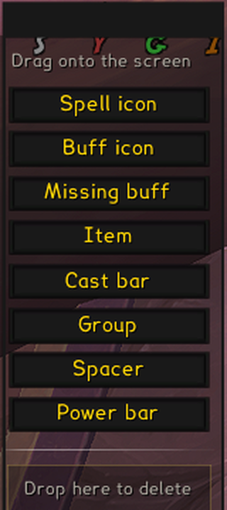

| Button | Creates |
|---|---|
| Spell icon | An ability cooldown icon. |
| Buff icon | An aura (buff / debuff) icon. |
| Missing buff | An icon that shows when a buff is missing. |
| Item | An item icon. |
| Cast bar | Your cast bar. |
| Group | A new empty group. |
| Spacer | An empty gap. |
| Power bar | A power bar that follows your current power (Auto). |

Hold **Alt** while you drop to place it loose. Dropping it back on the palette or the banner adds nothing. The new element is selected and its settings open.

Below the buttons is **Drop here to delete**: drop any element on it to delete it.

### Toolbar

The **Design mode** banner sits at the top of the screen. It shows two lines of hints, then the toolbar.

| Control | What it does |
|---|---|
| **Snap** | Snap to other elements, the screen center and the grid. |
| **Grid** | Shows or hides the grid. The center lines are gold. |
| **Grid W** | Space between vertical lines, 2-64 px (default 8). |
| **Grid H** | Space between horizontal lines, 2-64 px (default 8). |
| **Tidy wrappers** | Removes groups that hold only one thing, but only where nothing on screen moves. One Undo step, and a short report in chat. Same as `/cwk tidy`. |
| **Undo** | Takes back the last change. Dimmed when there is nothing to undo. |
| **Done** | Leaves design mode. |

Snap, Grid W and Grid H are also in **Settings > Behavior > Design mode** (Snapping, Grid width, Grid height). A change in one place shows in the other.

### Texts on icons and bars

Every text on an icon or bar can be moved, restyled or hidden. That includes the stack number. Click the element to open its settings, then go to the **Texts** tab.

| Element | Texts you can place |
|---|---|
| Icons (spell, aura, item, equipment) | Cooldown, Count (stacks, charges or items left), Keybind |
| Aura bar, Stack timers | Spell name, Time, Stacks |
| Stacks (pips) | Stacks |
| Cooldown bar | Spell name, Cooldown left |
| Charge bar | Recharge time |
| Cast bar | Spell name, Time, Latency |
| Swing bar | Hand, Seconds left |
| Power bar | Text 1, Text 2, Text 3 |

**The preview** shows the element as the game draws it, with its texts.

| Action | How |
|---|---|
| Pick a text to edit | Click it in the preview, or click its name in the row of tabs above the preview. Click a text again to pick the one under it. |
| Move a text | Drag it. On release it snaps to the nearest of 9 points (corners, edges, center) plus a whole-pixel offset. Gold dots show the points. |
| Move without changing its anchor | Hold **Alt** while you drag. |
| Nudge | Arrow keys move the picked text 1 px, **Shift** 5 px. They work after you click a text, until you click the empty preview, close the window, switch tab or enter combat. |
| Put it back | **Reset position**. |

**Selected text** options:

| Option | Icons | Bars | Power bar |
|---|---|---|---|
| Visible ("Show this text") | Yes | Yes | Yes |
| Size | Scale, 50-250 % | 6-32 px | 6-40 px |
| Width limit (longer text ends in "...") | Yes | Yes | Yes |
| Characters (max letters, then "...") | Yes | Yes | No |
| Rotation (0° / 90° / 180° / 270°) and Angle (-180° to 180°) | Yes | Yes | Yes |
| Color | Yes | Yes | Yes |
| Timer texts | Cooldown: Tenths, Color by time left (up to several "Under N s" colors, **+ Add color**) | Time: Shows (Left, Done, Total or "Left / Total"; stack timers also Next drop), Tenths, Seconds sign | Shows (format), Power, Percent sign |

Rotation rows appear only when your game client can turn text. Font, outline, shadow and overall text size are set once for every text in **Settings > Font**.

### Undo & safety

- **Undo** keeps your last 30 changes: moves, nudges, drops, inserts, deletes, grouping, Tidy, saved anchors and edits from the settings window.
- Delete never asks first. Use Undo to bring it back.
- Undo history is for the current design only, and is lost on `/reload`.
- **Collapse warnings:** a group whose row can't collapse in combat shows a yellow **!** badge at its top right. Hover it to see why. Click it to open the group. Its General tab explains the problem and often has a **Fix** button.
- If a change you make breaks a row's collapse, chat tells you once. Rows that are still broken are listed in chat when you press **Done**.

---

## Every window

<b>Settings window</b> (General, Behavior, Font, Elements)

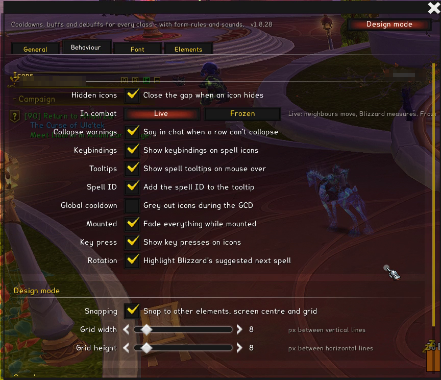

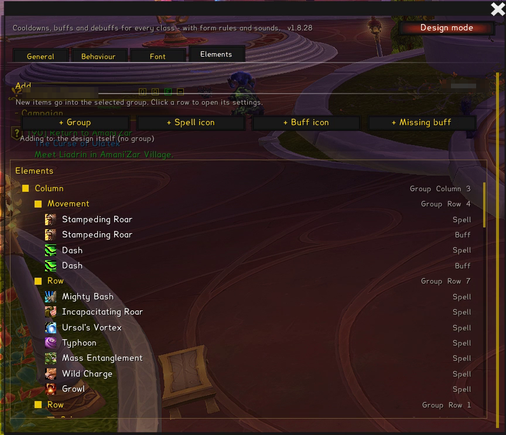

<b>Design mode</b> (enter, toolbar, selected group, add menu)

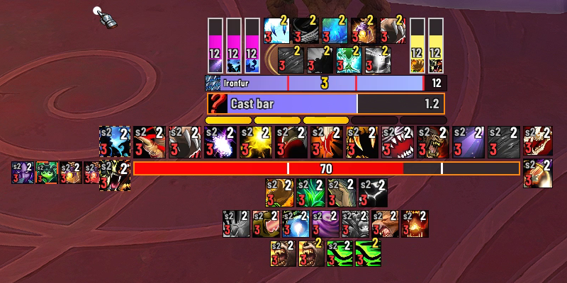
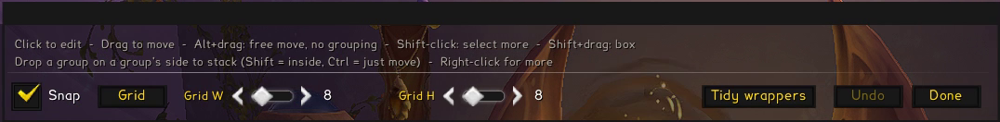

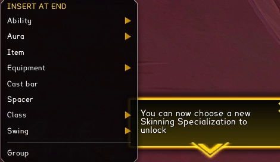
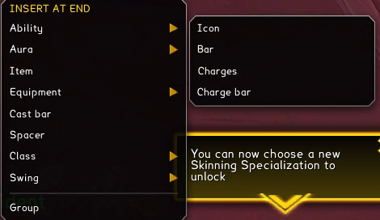

<b>Icon</b> (General, Spell, Texts, Cooldown, Active, Forms, Create preset)

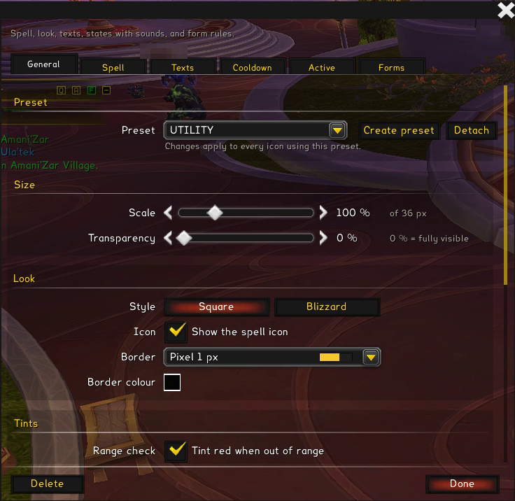
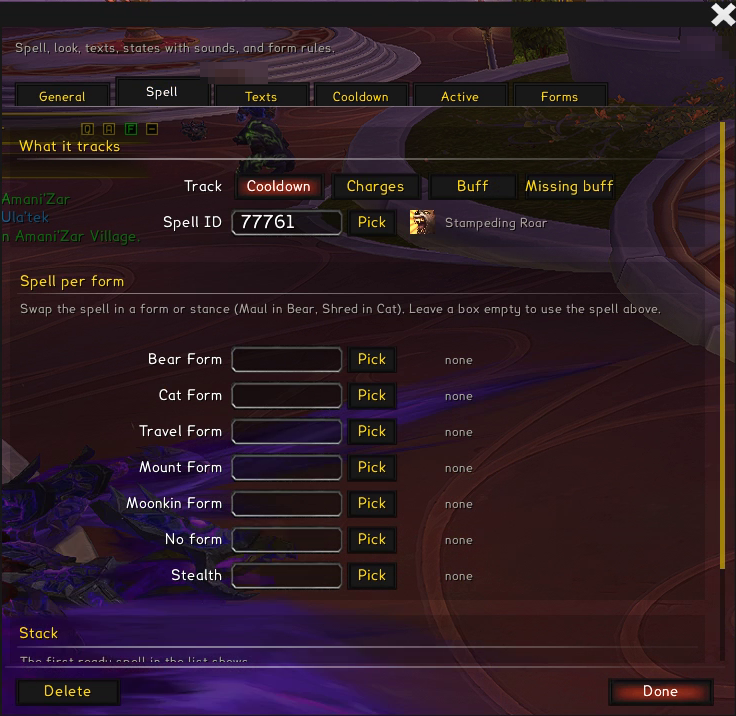

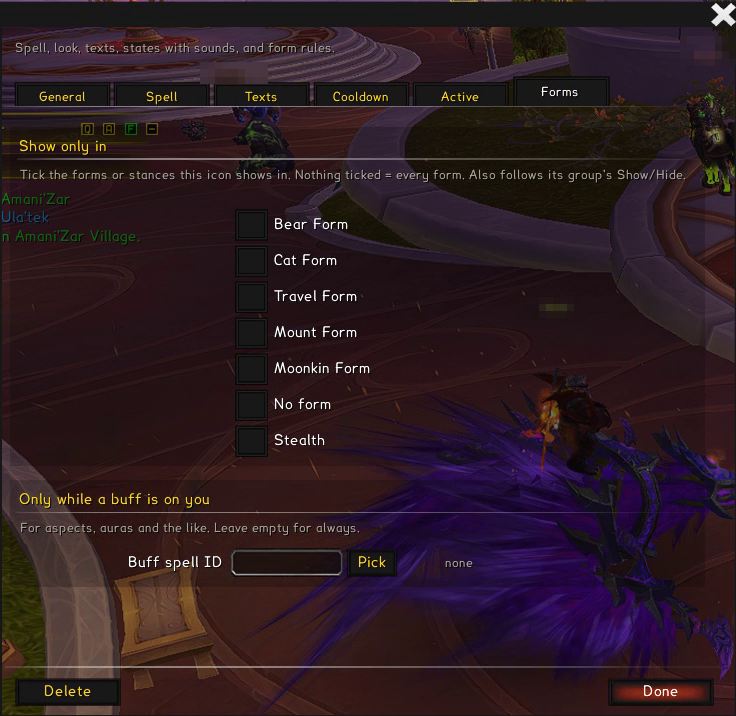

<b>Group</b> (General, Show / Hide)

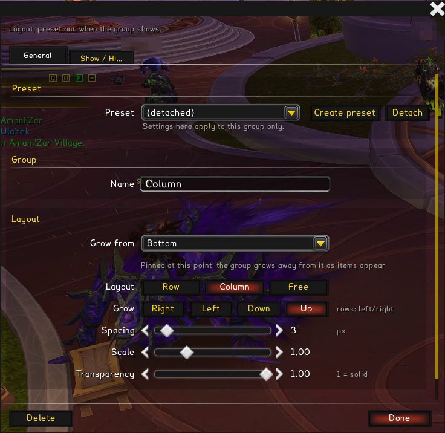
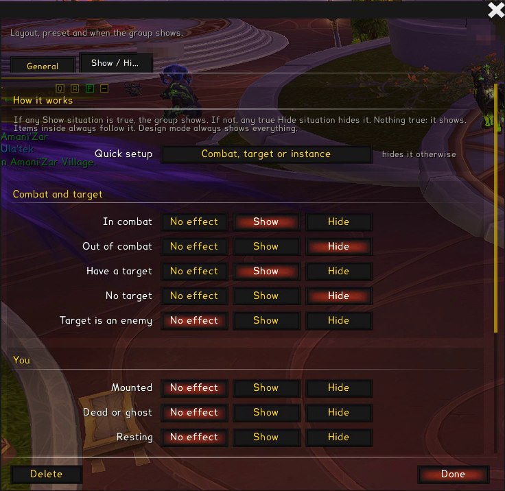

<b>Aura bar</b> (General, Bar, Colors, Texts, Forms)

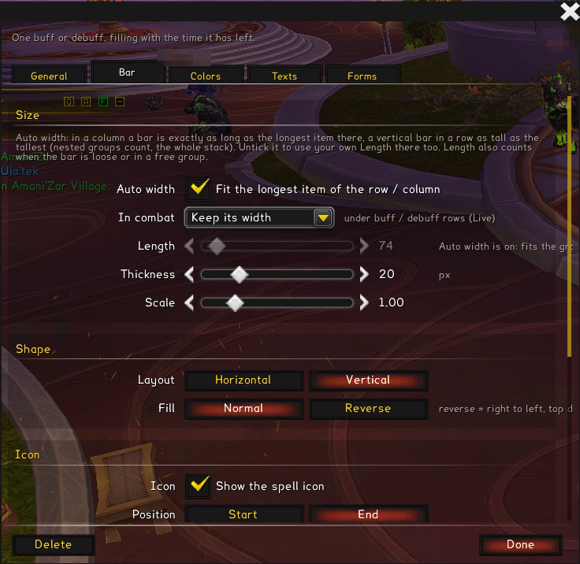
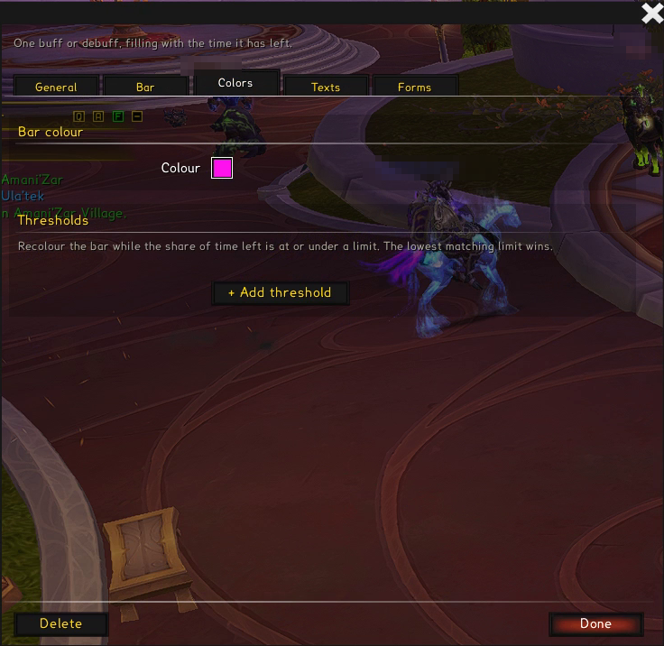
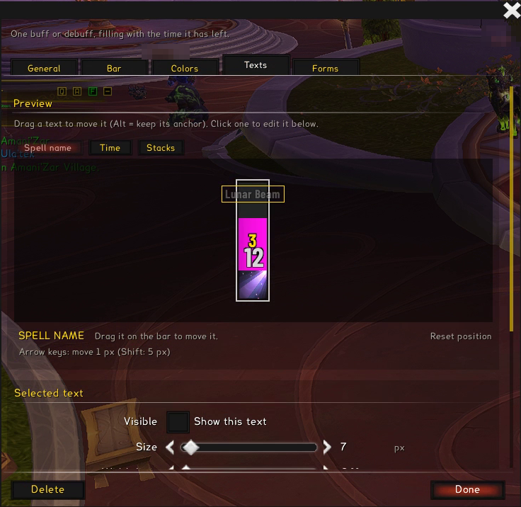

<b>Cast bar</b> (General, Bar, Colors, Texts)

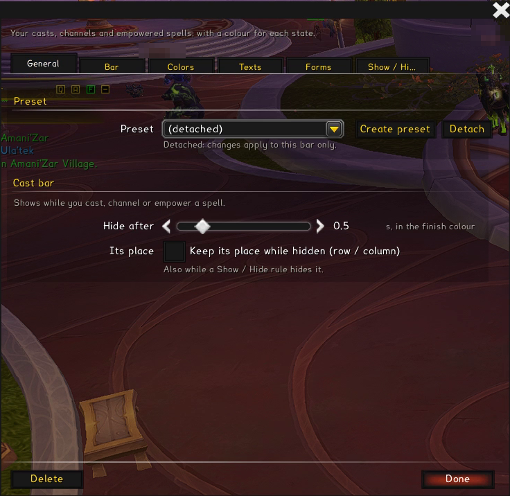

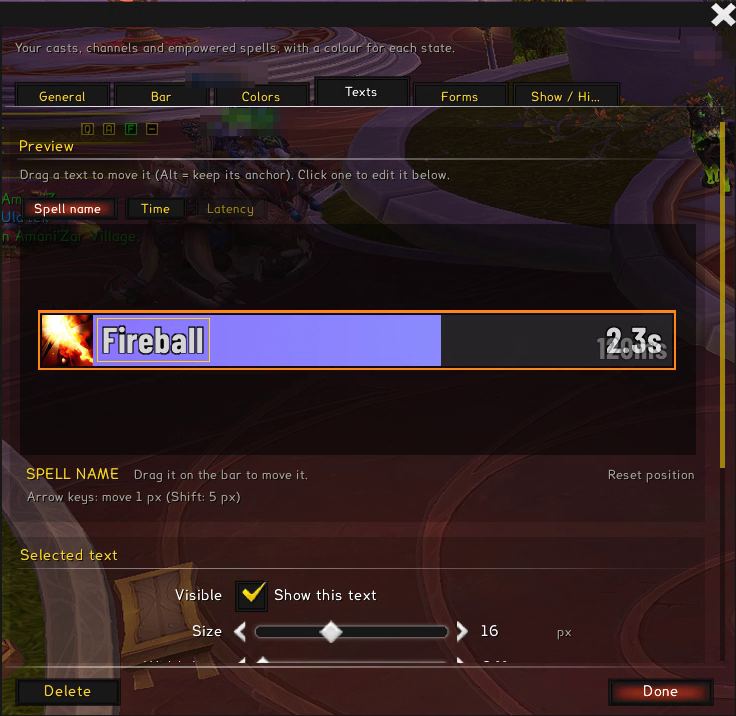

<b>Power bar</b> (General, Look, Texts, Forms, Show / Hide)

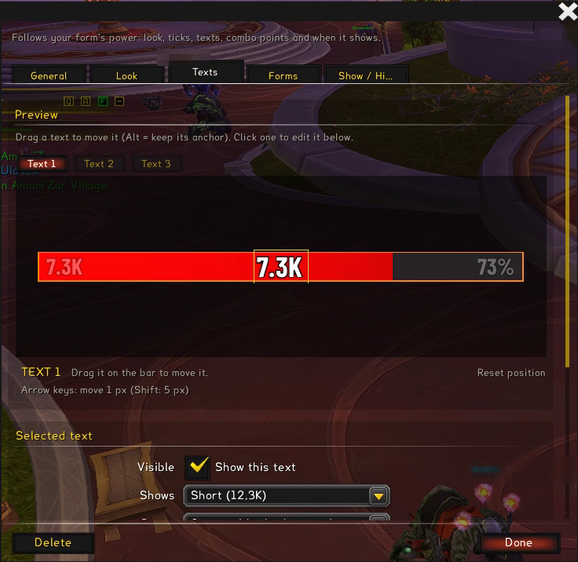
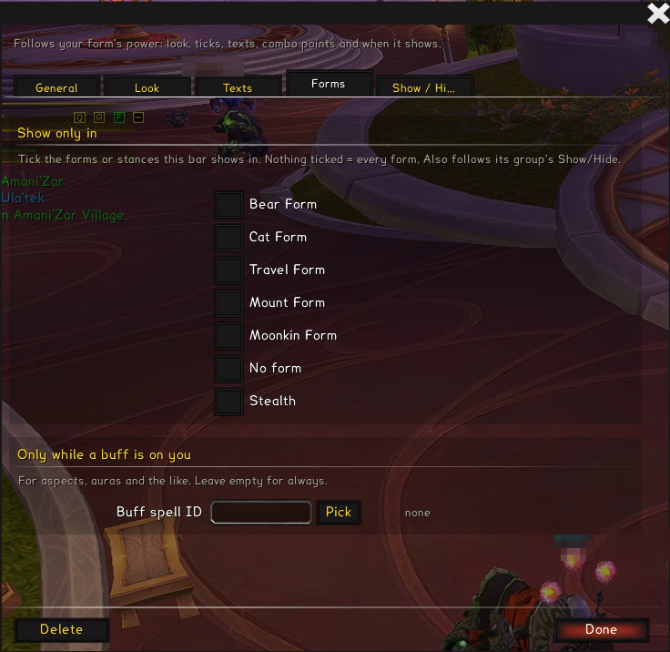

<b>Pickers</b> (spells, buffs, items, equipment)

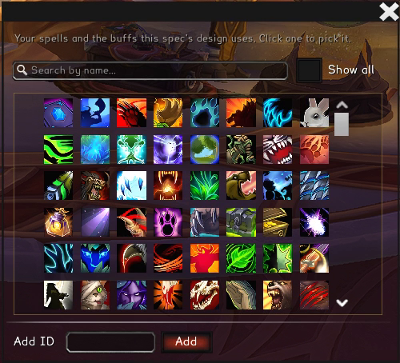

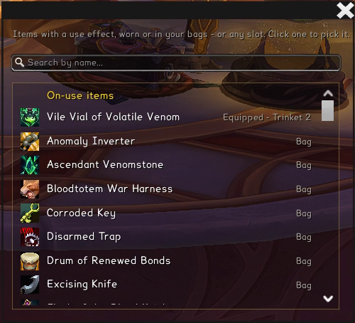

---

## Install

1. Get Clockwork from [CurseForge](https://www.curseforge.com/projects/1819552) – the easiest way is the CurseForge app, which also keeps it up to date. Or press **Download** on the CurseForge page.
2. If you downloaded the zip yourself, unzip it. You get a folder named `Clockwork`.
3. Put that folder in your AddOns folder:
   - Retail: `World of Warcraft/_retail_/Interface/AddOns/`
   - WoW Forever: `World of Warcraft/_forever_/Interface/AddOns/`
4. Start the game (or `/reload`) and make sure Clockwork is ticked in the AddOns list.

## Quick start

New to Clockwork? On your first login a **Choose a starter layout** window offers a ready-made layout for your class and spec (Compact, Wide, or Healer). Pick one and tune it – or type `/cwk starter` any time.

1. Type `/cwk` to open the settings.
2. Each class and spec has its own design, picked automatically. Make a new one under *General → Design for this class and spec*.
3. Press **Design mode** (or `/cwk d`) and drag a Spell icon, Buff icon or bar from the palette onto the screen.
4. Click it to pick the spell, then give it a **Preset** – or **Create preset** to reuse the look on other icons.
5. Press **Done**.

## Slash commands

| Command | What it does |
|---|---|
| `/cwk` (or `/clockwork`) | Open or close the settings window |
| `/cwk d` | Design mode (drag to move, Alt+drag = free move, Shift-click = select more) |
| `/cwk help` | List the commands in chat |
| `/cwk debug` | Save a debug report for bug reports, then `/reload` |
| `/cwk auras` | Check what every aura icon sees now (in and out of combat), then `/reload` |
| `/cwk livetest` | Check the calls the live collapse uses (in and out of combat) |
| `/cwk tidy` | Remove groups that only wrap one thing (only where nothing moves; Undo in design mode) |
| `/cwk aliases reset` | Forget the aura IDs Clockwork learned for your aura icons |
| `/cwk starter` | Add a ready-made starter layout for your class and spec (deletes nothing) |
| `/cwk tour` | Show every window and tab by itself, 4 s each (`/cwk tour stop` ends it) |

## FAQ

**Does it work in combat?**
Yes. Cooldowns, charges, auras and bars all run in combat, and rows close up mid-fight. Design mode closes itself when combat starts.

**Retail or WoW Forever?**
Both: Retail 12.x and WoW Forever 1.60.x, from the same download.

**My row doesn't close the gap.**
Look for the yellow **!** on the group in design mode, read its tooltip and press **Fix** in the group's General tab. `/cwk debug` names the row, icon and reason.

**Live or Frozen?**
**Frozen** (the default, recommended) closes gaps in combat from positions Clockwork worked out beforehand. **Live** (beta) lets Blizzard measure the rows live; it can still overlap side bars a little in some layouts. Switch it under *Behavior → Hidden icons → In combat*.

**Can I bring my Coolinator setup?**
Yes. *Options → General → Import from Coolinator* reads your Coolinator settings and adds its designs – spells, groups and positions – as Clockwork designs.

**Does it cost FPS?**
It's built to stay light: event-driven, several events in one frame become one update, and what a fight can show is made before combat. Per-frame work runs only for what is moving – glowing icons, running timers, cast and swing bars – and, in combat, for collapsing rows that close gaps.

**Can I move or resize everything?**
Yes – everything is drag-and-drop in design mode, and every element has its own settings window.

## Discord

Join the [**Clockwork Discord**](https://discord.gg/j3TH89X9wZ) for help, bug reports, ideas and release news. Type `/bug` or `/idea` there for a quick form, and pick **Release Pings** in #welcome to hear about new versions.

## Ideas & feature requests

Missing an option? Clockwork grows from players' ideas – most of its features started as a request.
[**Suggest a feature**](https://github.com/xxxstar123/Clockwork-WoW-CDM-Addon/issues/new?template=feature_request.yml) – tell us what you want it to do and for which class / spec. Or post it in the [Discord](https://discord.gg/j3TH89X9wZ) (`/idea`).

## Bug reports

Open a [**bug report**](https://github.com/xxxstar123/Clockwork-WoW-CDM-Addon/issues/new?template=bug_report.yml), or use `/bug` in the [Discord](https://discord.gg/j3TH89X9wZ). Please include:

1. Your client (Retail or Forever) and Clockwork version.
2. What you did, what you expected, and what happened.
3. A debug report: type `/cwk debug`, then `/reload`. The report is saved in `WTF/Account/<account>/SavedVariables/Clockwork.lua`. Attach that file (check it first – it holds your Clockwork settings).

## Support Clockwork

Clockwork is free. If it helps you, you can support its development – entirely optional, and much appreciated.

## License

Copyright © 2026 xxxstar123. **All rights reserved.**
You are free to download Clockwork and use it in the game. Copying, modifying or redistributing the code requires written permission, and **no AI use** is allowed – no training, and no AI tools or agents reusing the code. See [LICENSE](LICENSE) and [AGENTS.md](AGENTS.md).

See [CHANGELOG.md](CHANGELOG.md) for recent changes.
