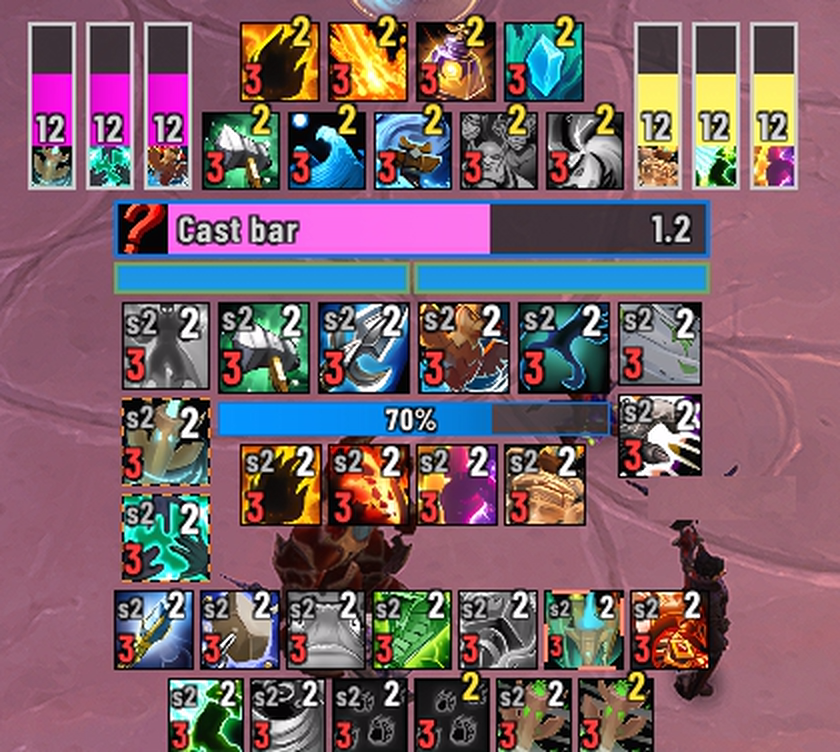
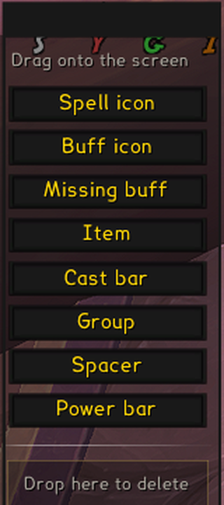
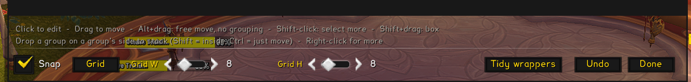

[← Back to Clockwork](https://github.com/xxxstar123/Clockwork-WoW-CDM-Addon#readme)

# Design mode guide

Design mode is where you build your layout on screen. Every group, icon and bar unlocks. You can drag things, add new ones, group them and line them up. Your character still moves with WASD and the camera still turns.

## Getting started

| Action | How |
|---|---|
| Open design mode | Type `/cwk d` (also `/cwk design`), or press **Design mode** at the top of the settings window (`/cwk`). |
| Leave design mode | Press **Done** on the banner, press **Esc**, type `/cwk d` again, or press **Leave design mode** in the settings window. |
| In combat | Design mode won't open in combat. If combat starts while it is open, it closes by itself. |

While design mode is on, every element is shown, even ones that are normally hidden. When you leave, your normal Show / Hide rules come back.

## Selecting

| Action | How |
|---|---|
| Select one element and open its settings | Left-click it. |
| Add to or remove from the selection | **Shift-click**. |
| Box select | **Shift+drag** on empty screen. Everything whose center is inside the box is selected. |
| Add a box to the selection | **Ctrl+Shift+drag**. |
| Clear the selection | **Shift-click** on empty screen. |
| Select the group around an item | Click the **Select group** button (small box icon) above it. Click it again on that group to go one more level up. |
| Edit several at once | Select them, then change a setting in the settings window. It shows "(N selected)" in its title. |

A plain click on empty screen goes to the game as usual (targeting, click-to-move). It does not change the selection.

**What you see**

- **Hover:** a thin gold outline and a name tag.
- **Selected:** a full gold outline and a name tag with white text. Groups get a thicker outline than icons and bars.
- **Empty group:** a dashed box with "Drop icons here", so you can still find it and drop things in.
- **Icons:** hover to see the spell's tooltip and its Spell ID (turn this off with the Tooltips option).

## Moving & snapping

Drag any element with the left mouse button. What happens on the drop depends on where it lives and where you drop it. You always see it first: the target group gets a gold frame, and a gold line shows where it will go in a row or column.

| Action | How |
|---|---|
| Move | Drag it. If it is selected with others, they all move together. |
| Free move (never join, stack or group) | Hold **Alt** while you drag. An item from a row or column comes out loose where you drop it. |
| Reorder inside a row or column | Drag the item along the row. The gold line shows the new spot. |
| Put an item into a group | Drop it inside the group. You can also drop it just past the end of a row or column. |
| Take an item out of a group | Drag it out of the group and drop it on empty screen. A gray **Free** label shows when it will become loose. You can also right-click it and choose **Move out of group**. |
| Put something between two groups | Drop it near the edge of a group inside a row or column. It goes beside that group, not into it. |
| Group two icons | Drop a loose icon on another loose icon. A gold **Group** label shows. Both go into a new row. |
| Stack groups | Drag a group onto another group. A gold **Stack** label and line show the side (above, below, left or right). The nearest side wins. |
| Drop a group *inside* another group | Hold **Shift** while you drop it. |
| Just move a group (no stacking) | Hold **Ctrl** while you drop it. |
| Delete | Drop it on **Drop here to delete** at the bottom of the palette. The box turns red when you are over it. |
| Turn the camera | Right-drag, as usual. A right-drag never opens a menu. |

**Snapping** (when **Snap** is ticked on the banner):

- Works on elements that sit loose on the screen (not inside a group).
- Snaps within 8 px to the screen center and to the edges and centers of other loose elements. A gold guide line shows what it snapped to.
- When nothing is close, it snaps to the grid (Grid W / Grid H).

A group that becomes empty because you moved or deleted its last item is removed by itself. A new empty group you added stays.

## The move handle

Select one element and a small square with a gold 4-way arrow appears in its exact center. Other buttons sit in a strip above the element.

| Control | What it does |
|---|---|
| **Move handle** (4 arrows, center) | Drag to move the element. Click to open its settings. Right-click for its quick menu (the same menu as right-clicking the element). |
| **Pencil** (groups) | Opens the group's settings. Tooltip: "Options". |
| **Select group** (small box, items and groups inside a group) | Selects the group around it. |
| **X** (top right) | Deletes it. Undo brings it back. |
| **Name tag** | Shows the element's name, next to the X. |
| **+** buttons | Add something new. Hover one to see a gold line where the new element will go. See below. |

**The + buttons**

- At both ends of a selected row or column: **Insert at start** / **Insert at end**. A free group has one **+** at its top right.
- Beside a selected item, along its row or column: **Insert before** / **Insert after**.
- Across its row or column: **Insert above** / **Insert below** (in a row) or **Insert left** / **Insert right** (in a column). This wraps the item and the new one in a new row or column.

Each **+** opens the add menu:

| Menu row | Choices |
|---|---|
| **Ability** | Icon, Bar, Charges, Charge bar |
| **Aura** | Icon, Bar, Stacks, Stack timers, Missing buff |
| **Item** | (an item icon) |
| **Equipment** | Pick an item..., Trinket 1, Trinket 2 |
| **Cast bar** | (your cast bar) |
| **Spacer** | (an empty gap) |
| **Class** | Your own class resources only, then **Auto (form)** |
| **Swing** | Main hand, Off hand, Ranged |
| **Group** | (a new empty group) |

Rows that aren't available yet are gray and marked "soon". The new element takes the look of the item next to it. Then the spell, aura or item picker opens so you can choose what it tracks. If there is nothing to pick, its settings open.

## Right-click menus

Right-click an element (or its move handle). The menu depends on what you clicked.

**A group**

| Entry | What it does |
|---|---|
| Options | Opens the group's settings. |
| Insert left / right / above / below ▸ | Only for a group inside another group. Opens the add menu for that side. |
| Ungroup | Breaks the group up. Its items stay where they are on screen and are selected. |
| Tidy wrappers (whole design) | Same as the banner's **Tidy wrappers** button. |
| Move out of group | Only for a group inside another group. Moves it out, right after its old group. |
| Center horizontally | Centers it left-right: on the screen, or inside its free group. |
| Center vertically | Centers it top-bottom: on the screen, or inside its free group. |
| **Saved anchors** | |
| Align *name* | Moves the group's center to a saved anchor. One row per anchor, or "No saved anchors". |
| Save anchor as... | Type a name and press **Save** (or Enter) to save this group's center as an anchor. |
| Delete saved anchors | Removes all saved anchors. |

Center horizontally / vertically are gray for a group inside a row or column (the row places it). Saved anchors work only for groups that sit loose on the screen. They are not tied to one design, so you can line up groups across designs.

**An icon, bar or other item**

| Entry | What it does |
|---|---|
| Options | Opens its settings. |
| Insert left / right / above / below ▸ | Opens the add menu for that side. |
| Move out of group | Only inside a group. Makes it loose at the same place on screen. |
| **Stack** (spell and aura icons) | |
| Add spell to this slot | Pick another spell that shares this icon's slot. |
| Clear stack | Shown when the slot has more than one spell. Shows how many on the right. |
| Delete | Deletes it (red). |

An item that sits loose on the screen becomes a new row or column with the new element when you use Insert.

**Several selected** (right-click one of them)

| Entry | What it does |
|---|---|
| Group these | Puts them in a new row, in screen order (left to right). |
| Group these as column | Puts them in a new column, in screen order (top to bottom). |
| Delete | Deletes them all (red). |

The menu header shows how many are selected. Click anywhere else to close a menu.

## Keyboard

| Key | What it does |
|---|---|
| Arrow keys | Move the selection 1 px. |
| Shift + arrow keys | Move the selection 10 px. |
| Esc | Closes an open menu. With no menu open, leaves design mode. |
| Enter / Esc in the anchor name box | Save / cancel. |

Arrow keys move loose elements and items in free groups. Items in a row or column keep their slot. Quick presses (less than 1 second apart) count as one Undo step. The arrow keys go back to the game the moment you leave design mode. There is no keyboard shortcut for Undo or Delete. Use the **Undo** button and the **X** or the bin.

## Palette

The **Add** panel sits at the bottom left. Drag a button onto the screen, into a group, or beside a group. You see the same gold frames and lines as when you move things.

| Button | Creates |
|---|---|
| Spell icon | An ability cooldown icon. |
| Buff icon | An aura (buff / debuff) icon. |
| Missing buff | An icon that shows when a buff is missing. |
| Item | An item icon. |
| Cast bar | Your cast bar. |
| Group | A new empty group. |
| Spacer | An empty gap. |
| Power bar | A power bar that follows your current power (Auto). |

Hold **Alt** while you drop to place it loose. Dropping it back on the palette or the banner adds nothing. The new element is selected and its settings open.

Below the buttons is **Drop here to delete**: drop any element on it to delete it.

## Toolbar

The **Design mode** banner sits at the top of the screen. It shows two lines of hints, then the toolbar.

| Control | What it does |
|---|---|
| **Snap** | Snap to other elements, the screen center and the grid. |
| **Grid** | Shows or hides the grid. The center lines are gold. |
| **Grid W** | Space between vertical lines, 2-64 px (default 8). |
| **Grid H** | Space between horizontal lines, 2-64 px (default 8). |
| **Tidy wrappers** | Removes groups that hold only one thing, but only where nothing on screen moves. One Undo step, and a short report in chat. Same as `/cwk tidy`. |
| **Undo** | Takes back the last change. Dimmed when there is nothing to undo. |
| **Done** | Leaves design mode. |

Snap, Grid W and Grid H are also in **Settings > Behavior > Design mode** (Snapping, Grid width, Grid height). A change in one place shows in the other.

## Texts on icons and bars

Every text on an icon or bar can be moved, restyled or hidden. That includes the stack number. Click the element to open its settings, then go to the **Texts** tab.

| Element | Texts you can place |
|---|---|
| Icons (spell, aura, item, equipment) | Cooldown, Count (stacks, charges or items left), Keybind |
| Aura bar, Stack timers | Spell name, Time, Stacks |
| Stacks (pips) | Stacks |
| Cooldown bar | Spell name, Cooldown left |
| Charge bar | Recharge time |
| Cast bar | Spell name, Time, Latency |
| Swing bar | Hand, Seconds left |
| Power bar | Text 1, Text 2, Text 3 |

**The preview** shows the element as the game draws it, with its texts.

| Action | How |
|---|---|
| Pick a text to edit | Click it in the preview, or click its name in the row of tabs above the preview. Click a text again to pick the one under it. |
| Move a text | Drag it. On release it snaps to the nearest of 9 points (corners, edges, center) plus a whole-pixel offset. Gold dots show the points. |
| Move without changing its anchor | Hold **Alt** while you drag. |
| Nudge | Arrow keys move the picked text 1 px, **Shift** 5 px. They work after you click a text, until you click the empty preview, close the window, switch tab or enter combat. |
| Put it back | **Reset position**. |

**Selected text** options:

| Option | Icons | Bars | Power bar |
|---|---|---|---|
| Visible ("Show this text") | Yes | Yes | Yes |
| Size | Scale, 50-250 % | 6-32 px | 6-40 px |
| Width limit (longer text ends in "...") | Yes | Yes | Yes |
| Characters (max letters, then "...") | Yes | Yes | No |
| Rotation (0° / 90° / 180° / 270°) and Angle (-180° to 180°) | Yes | Yes | Yes |
| Color | Yes | Yes | Yes |
| Timer texts | Cooldown: Tenths, Color by time left (up to several "Under N s" colors, **+ Add color**) | Time: Shows (Left, Done, Total or "Left / Total"; stack timers also Next drop), Tenths, Seconds sign | Shows (format), Power, Percent sign |

Rotation rows appear only when your game client can turn text. Font, outline, shadow and overall text size are set once for every text in **Settings > Font**.

## Undo & safety

- **Undo** keeps your last 30 changes: moves, nudges, drops, inserts, deletes, grouping, Tidy, saved anchors and edits from the settings window.
- Delete never asks first. Use Undo to bring it back.
- Undo history is for the current design only, and is lost on `/reload`.
- **Collapse warnings:** a group whose row can't collapse in combat shows a yellow **!** badge at its top right. Hover it to see why. Click it to open the group. Its General tab explains the problem and often has a **Fix** button.
- If a change you make breaks a row's collapse, chat tells you once. Rows that are still broken are listed in chat when you press **Done**.

---
