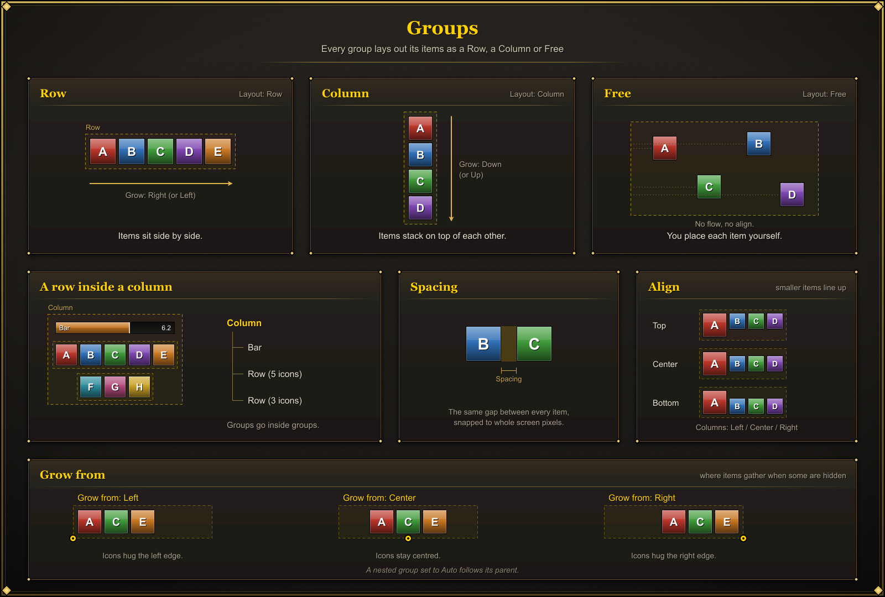
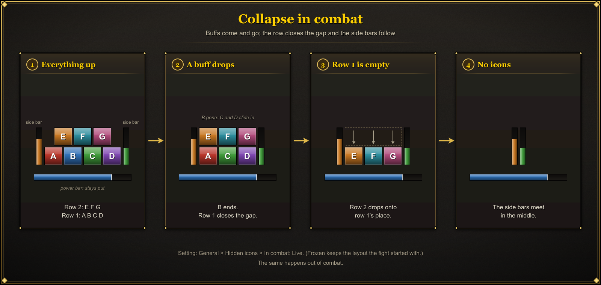
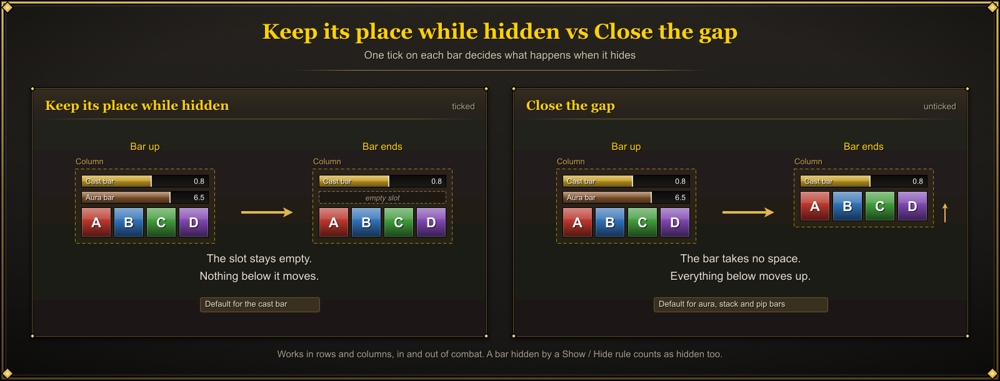
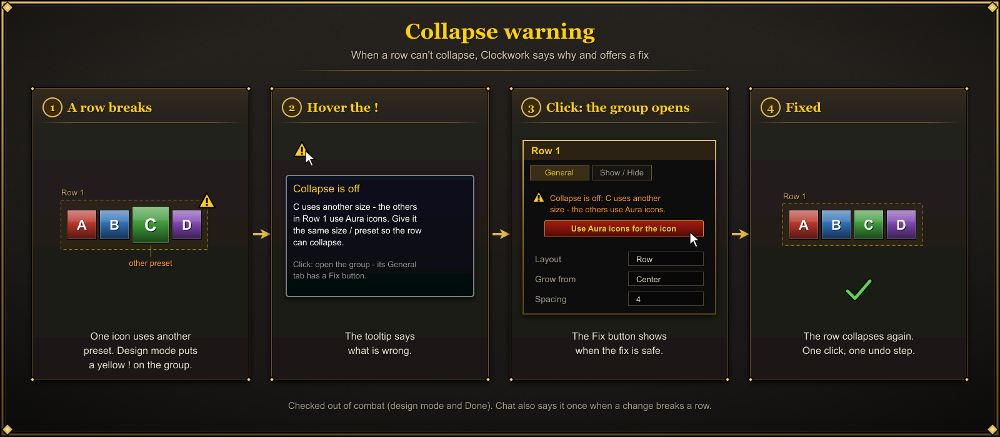

# Groups & growth: a tutorial

A plain, step-by-step guide to how groups work in Clockwork, how items flow inside them, and how to set growth and anchors so your layout stays stable and pixel-perfect.



---

## 1. Group layouts: Row, Column and Free

Every group arranges its children (icons, bars or nested groups) by its **Layout** setting:

- **Row**: children sit side by side.
  - **Grow**: `Right` (items append left to right) or `Left`.
  - **Alignment**: top, centre or bottom of the row.
- **Column**: children stack vertically.
  - **Grow**: `Down` or `Up`.
  - **Alignment**: left, centre or right of the column.
- **Free**: you place each child yourself. No automatic flow.

**Spacing** sets the exact gap between neighbours in screen pixels (default 2–3 px). Every gap snaps to whole physical pixels.

---

## 2. Where it stays put vs. where it grows from

### A. Screen anchor ("stays put at")
The point of a top-level group that stays glued to the screen:
- **Bottom**: the bottom edge never moves; the group grows upward.
- **Center**: the group grows outward equally from its centre.
- **Top**: the top edge stays put; the group grows downward.

### B. Grow from
Where the children pin inside the group when items show or hide:
- **Center**: children centre on the group's axis; when items come and go, the rest shift around the middle.
- **Left / Right / Top / Bottom**: children pin to that edge and append in the grow direction.
- **Auto** (nested groups): follow the enclosing group.

---

## 3. Collapsing rows (side bars + aura icons)

A collapsing row holds aura icons in the middle and bars on each side.



- **No icons up**: the side bars slide in and meet in the middle.
- **Icons appear**: they claim the centre and push the side bars out evenly.
- **Two icon rows**: if the lower row is empty, the upper row drops into its place.
- **In combat**: the collapse runs on Blizzard's own aura frames, so it keeps working while auras are hidden from addons.
- **However you grouped it**: wrapper groups with one child and rows inside rows are read as one row, so `Row[left bars, Row[icon column, right bars]]` collapses exactly like `Row[left bars, icon column, right bars]`. `/cwk debug` prints how the row was read.

### Keep its place while hidden
Per bar:
- **Off (default)**: the bar takes no space while inactive; its neighbours close up.
- **On**: the bar keeps its empty slot, so nothing around it moves.



If a row can't collapse (for example an icon with a different size sits in the middle), Clockwork marks the group with a yellow **!** and offers a one-click **Fix** in the group's General tab.



---

## 4. Worked example: a tank layout

```
[Screen centre]
  |
  +-- Column  [Grow Up, Spacing 2, stays put at Bottom]
        |
        +-- Stack-timer bar  (one fill for every active application,
        |                     a sliding tick per cast)
        |
        +-- Collapsing row  [Grow from Center]
              |
              +-- Bars-Left   (vertical aura bars: big cooldowns)
              |
              +-- Centre column  [Grow from Center]
              |     +-- Upper row: procs and defensives (aura icons)
              |     +-- Lower row: rotational buffs (aura icons)
              |
              +-- Bars-Right  (vertical aura bars: defensives)
```

Why it works:
1. The top column grows **up** from its **bottom** anchor, so the ability icons below never jump when the stack-timer bar comes and goes.
2. The collapsing row grows from the **centre**, so bars and icons balance around your character.
3. The centre column grows from the centre too, so procs stay over your power bar.
4. With no auras up, the side bars meet in the middle; pop a defensive and it sits right beside your procs.

---

## 5. Rules of thumb

1. **Ability columns near the bottom of the screen**: Layout `Column`, Grow `Up`, stays put at `Bottom`. Adding or removing abilities never pushes the bar down.
2. **Buff rows near your character**: Layout `Row`, Grow `Right` (or `Left`), Grow from `Center`.
3. **Bars that fit their group**: in the bar's Bar tab, tick **Auto width**. The bar matches the longest item of its row or column. A row holding only such bars counts too.
